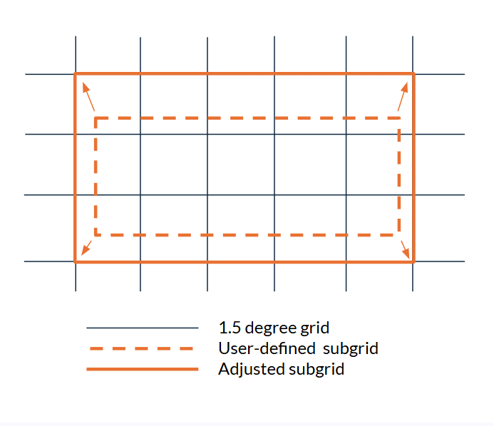

Bounding Box
============

.. important::
    This is a tool being developed by the ACACIA project. Please email feedback to joshua.talib@ecmwf.int.

All models in the ECMWF database run using different native resolutions; see `ECMWF's Model page <https://confluence.ecmwf.int/display/S2S/Models>`_ for details on each model.  However, all data in the ECMWF S2S database is mapped to the same 1.5 degree grid.

Within this 1.5 degree grid, the user can select a bounding box enclosing their area of interest using a range of parameters including ``country_name``, ``region_name``, and ``bbox_bounds``.  See page "Downloading Operational Forecasts" for more detail on possible user inputs.

The toolkit requires the bounding box to align with the global 1.5 degree grid. If it does not, the toolkit deals with this automatically by adjusting the requested co-ordinates outwards in each direction (N, S, E, W) until all four edges of the bounding box snap to the global 1.5 degree grid.  Note the adjustment is always made outwards, to ensure that the entire original area is included.

.. note::
    When the bounding box adjustment is made, the toolkit displays both the original requested and adjusted bounds.

   
Image: Schematic showing how the toolkit automatically snaps the user-selected bounding box outwards to the global 1.5 degree grid.

