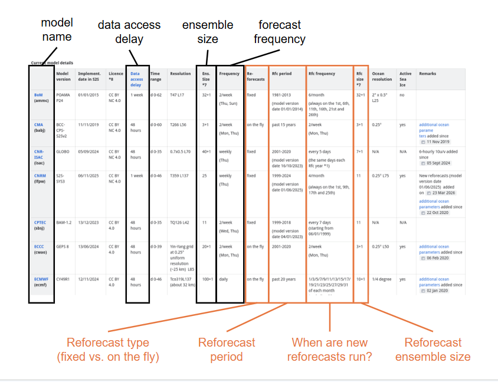

Models
======

.. important::
    This is a tool being developed by the ACACIA project. Please email feedback to joshua.talib@ecmwf.int.

The models available in the ECMWF S2S database differ from each other in many ways, including forecast frequency, ensemble size, and data access delay.  Different institutions also manage reforecasts differently.  A full summary of all models available in the ECMWF database can be found on the ECMWF `confluence page <https://confluence.ecmwf.int/display/S2S/Models>`_, where you can find useful information about each model in the following columns:

Image: where to find helpful information about how each model available in the ECMWF database manages forecasts (black boxes) and reforecasts (orange boxes).  This is an illustrative example; for up-to-date information please see the ECMWF `confluence page <https://confluence.ecmwf.int/display/S2S/Models>`_.

.. note::

    'ECMWF' will be selected as the default model if no model is specified by the user.
