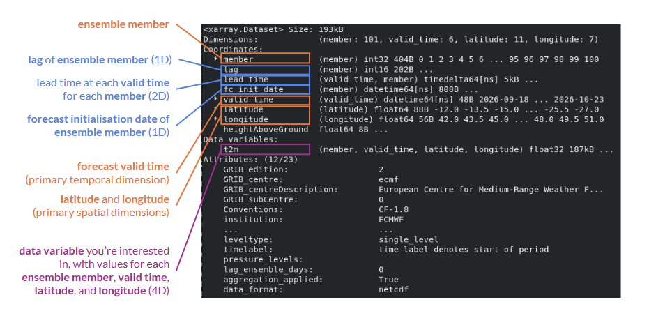
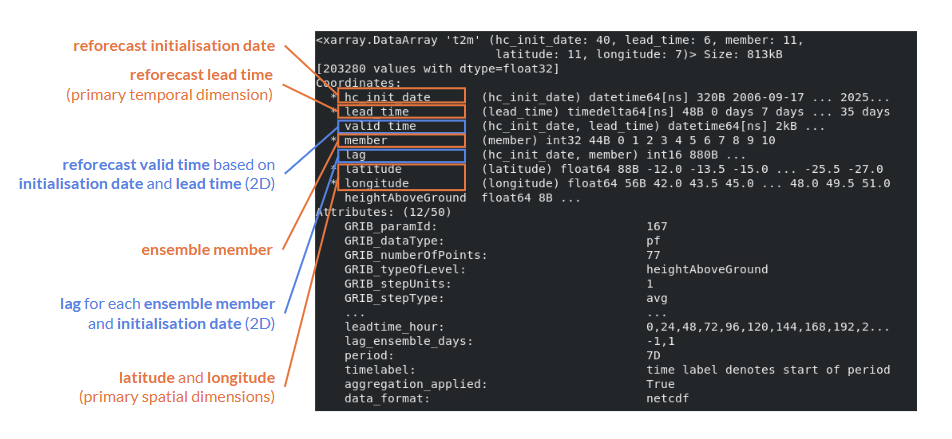

Basic Toolkit Output
====================

.. important::
    This is a tool being developed by the ACACIA project. Please email feedback to joshua.talib@ecmwf.int.

The toolkit outputs lots of information to help the user understand how a forecast/reforecast ensemble has been constructed, and how the data is organised.

Downloading a forecast
----------------------

The *download_forecast* function outputs data as an *xarray.Dataset* with the following structure:

   
Image: example of an *xarray.Dataset* containing output of the *download_forecast* function. Label key: main data dimensions (orange), data coordinates (blue), data variables (purple)

**Dimensions**: 
  - **member**: the ensemble member (e.g. 1-101)
  - **valid_time**: valid time of the forecast (used as the primary temporal dimension)
  - **latitude**: spatial position in the latitude direction
  - **longitude**: spatial position in the longitude direction

**Coordinates**: Additional information to describe points along each dimension.

  - **lag** (1D based on **member**): how offset the member's initialisation date is from the nominal start time, e.g. 0, -1, -2.  Note that for operational forecasts, only negative lags are available becasue positive lags would be in the future.  
  - **lead_time** (2D based on **member** and **valid_time**): lead time relative to the ensemble member's forecast initialisation date.  Lead time is aways defined relative to the member's own initialisation date, regardless of lag.
  - **fc_init_date** (1D based on **member**): forecast initialisation date for each member.
  - **heightAboveGround** (scalar): representative height of the variable.  For example, ``t2m`` is the 2m temperature variable so ``heightAboveGround=2.0`` applies to the whole dataset.

**Data variable** (4D based on **member**, **valid_time**, **latitude**, **longitude**): the variable that the dataset is descring, e.g. 2m temperature.  Each variable requires a separate download.  

Downloading a reforecast
------------------------

The *download_reforecast* function outputs data as an *xarray.Dataset* with the following structure:

   
Image: example of an *xarray.Dataset* containing output of the *download_reforecast* function.  Label key: main data dimensions (orange), data coordinates (blue), data variables (purple)

**Dimensions**: 
  - **member**: the ensemble member (e.g. 1-101)
  - **hc_init_date**: reforecast initialisation date for each ensemble member.  Reforecasts use hc_init_date rather than fc_init_date because multiple reforecast start dates are downloaded and stored together.
  - **lead_time**: lead time relative to the ensemble member's reforecast initialisation date.  lead_time is used as the primary temporal dimension for reforecasts rather than valid_time because for reforecasts, valid_time depends on hc_init_date and lead_time, meaning a single valid_time axis cannot represent all ensemble members consistently.
  - **latitude**: spatial position in the latitude direction
  - **longitude**: spatial position in the longitude direction

**Coordinates**: Additional information to describe points along each dimension.

  - **lag** (2D based on **hc_init_date** and **member**): the ensemble member's offset from the nominal start time, e.g. 0, -1, -2, +1, +2.  Note that for reforecasts, both negative and positive lags are available because we are dealing with forecasts in the past.  Different lag values are allowed for different hindcast dates and ensemble members.  . 
  - **valid_time** (2D based on **hc_init_date** and **member**): valid time of the forecast.
  - **heightAboveGround** (scalar): representative height of the variable.  For example, ``t2m`` is the 2m temperature variable so ``heightAboveGround=2.0`` applies to the whole dataset.

**Data variable** (5D based on **member**, **hc_init_date**, **lead_time**, **latitude**, **longitude**): the variable that the dataset is descring, e.g. 2m temperature.  Each variable requires a separate download.  

