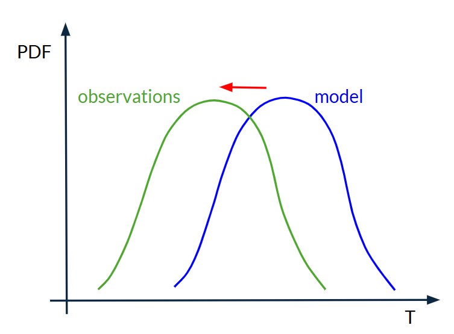
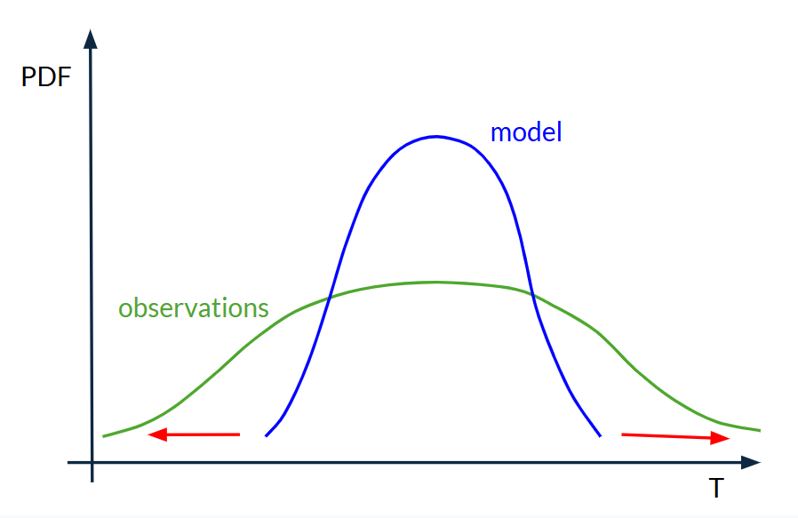
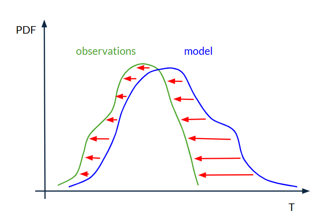

Bias Correction
===============

.. important::
    This is a tool being developed by the ACACIA project. Please email feedback to joshua.talib@ecmwf.int.

There are different types of bias correction available depending on what characterstics of your operational forecast model you want to calibrate.

Mean Bias Correction
--------------------

If reforecasts show the model is typically 1.5°C too warm, subtract 1.5°C from the operational forecast.  This is good for removing simple systematic biases.

   
Image: Schematic showing mean bias correction.

Variance Correction
-------------------

Sometimes the model gets the average right but the forecast range is too narrow or too wide.  For example, reforecasts may show that the model consistently predicts anomalies within +/-1°C when observations vary by +/-2°C.  In this case, it is the forecast **variability** that needs correcting.  So, the operational forecast can by stretched (or compressed) to better match reality.  

   
Image: Schematic showing variance correction.

Variance correction works best when the model and observations have similar, close to normal (bell-shaped), distributions.  This is often not the case, particularly for rainfall where the distribution is heavily skewed towards low rainfall events.

Quantile Mapping 
----------------

This is a more sophisticated technique that is able to deal with more complicated distributions.  It determines where a forecasted value sits within the modelled distribution (say, at the 63rd percentile) and then asks what value occurs at the same percentile in the observed distribution.  Each quantile therefore receives a different correction, adjusting the entire distribution shape. 

   
Image: Schematic showing quantile mapping.

The simplest version of quantile mapping is called **empirical quantile mapping (EQM)**.  But in addition to removing model bias, EQM can also distort or remove long-term trends in modelled data.  This is undesirable for applications such as seasonal forecasting and climate projections, where long-term trends often represent a real, useful signal (e.g. global warming).  A more sophisticated version of quantile mapping, called **detrended quantile mapping (DQM)**, addresses this by temporarily removing the long-term trend from the model data, applying quantile mapping to the detrended data, and then adding the trend back afterwards. This preserves the long-term trend while still correcting biases in the model's distribution.

