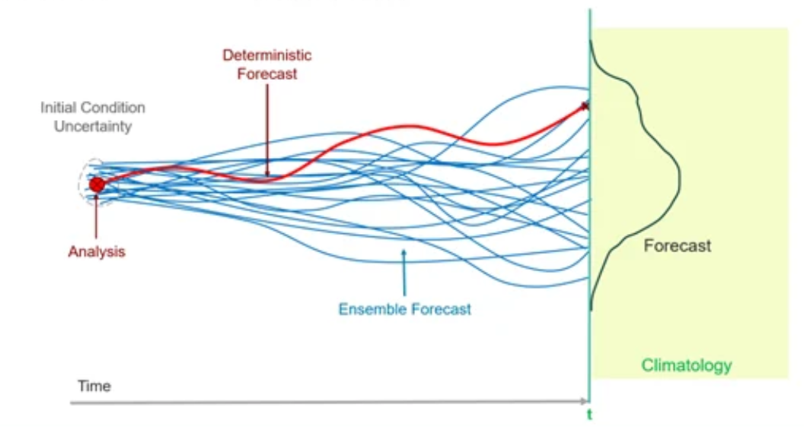
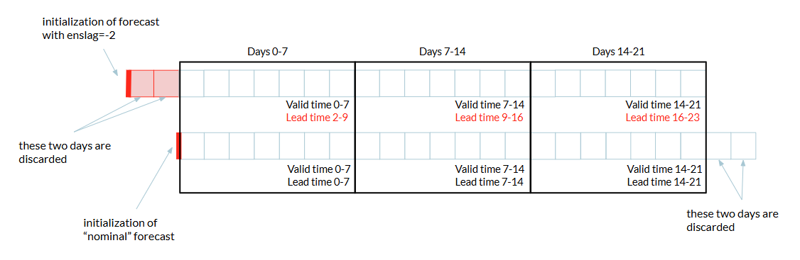

Ensembles & Lagged Ensembles
============================

.. important::
    This is a tool being developed by the ACACIA project. Please email feedback to joshua.talib@ecmwf.int.

Ensembles 
---------

Becasue the atmosphere is chaotic, a forecast model is sensitive to initial conditions and will quickly lose skill.  In other words, if you run the model multiplie times, each forecast will have a different outcome. 

This is impossible to avoid, so to get around it, forecasters run the same forecast multiple times to form an **ensemble**.  Instead of creating a single forecast that gives one possible version of the future, an ensemble allows us to see how likely certain versions of the future are, by analysing the agreement (or perhaps lack of agreement) between the ensemble members.

   
Image: Simple example of an ensemble.

This approach allows forecasters to reduce random noise in model runs, produce more robust probability estimates, and better representation of forecast uncertainty.

Lagged Ensembles
----------------

In order to derive reliable statistics about model performance, you need lots of data, and that means lots of ensemble members.  But operational constraints mean that ensemble sizes are limited.  We can artificially build a much larger ensemble by taking forecasts that were initialised earlier, say -1 day or -2 days, and stacking these on top, effectively doubling or tripling the size of the final ensemble.  

To ensure all ensemble members verify over the same target period, the start and end portions that are not common to every forecast are trimmed off, leaving only the overlapping period where all ensemble members are available.

Notice that the ensemble member(s) with the lag of -2 days will have been operationalised 2 days earlier, so at the same valid time, its lead time will be 2 days longer.  This impacts its skill, but usually the increase in sample size by making the ensemble larger, outweighs the loss from using slightly older forecasts, especially at subseasonal and seasonal timescales.
    

   
Image: Simple example of a lagged ensemble using lags of 0 and -2, showing trimmed portions that are discarded, and illustrative valid times and lead times.

