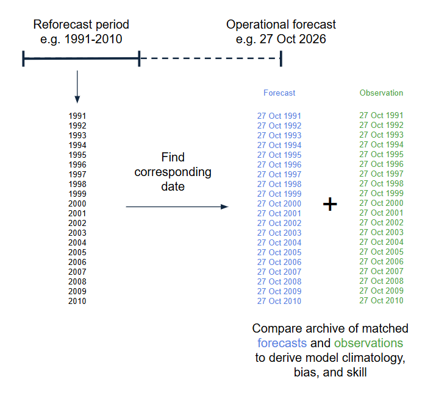

What is a Reforecast? 
=====================

.. important::
    This is a tool being developed by the ACACIA project. Please email feedback to joshua.talib@ecmwf.int.

A reforecast is like an operational forecast but it is run for a past date where we already know the outcome.  This is sometimes also called a hindcast, and in this toolkit the terms can be used interchangeably.  By running reforecasts for lots of past dates, we can quickly build a large archive of forecasts (prediction) and their corresponding observations (reality).

Being able to compare a large number of forecasts to observations means that we can create a statistically robust estimate of the **forecast skill** of the model, for any of its variables, at any lead time.

It also allows us to detect and correct **model bias**.  In addition to random uncertainty, models will consistently over-estimate or under-estimate certain things (for example, a model might consistently run too warm by 1.5C).  Such systematic errors can be difficult to distinguish from random forecast errors without a large archive of historical forecasts to cancel out most of the random error. Reforecasts provide this archive, allowing us to characterise the model's typical behaviour (its **model climatology**).  By comparing the model climatology to observations (the observed climatology) we can calculate the model bias and account for this in operational forecasts.

How are Reforecasts Used in Practice?
-------------------------------------

A set of reforecasts may span the twenty year period 2001-2020.  In the simplest case, this gives us 20 past examples of what the model predicted on a certain calendar date (say, the date of today's operational forecast), at a certain lead time.  Each example can then be matched to past observations to determine how well the model performed each time.  By taking the average performance of the model over those 20 years we can derive the model climatology, model bias, and forecast skill.  Today's operational forecast can then be calibrated and bias-corrected.

Image: how a reforecast generates an archive of past forecasts and matched observations for a certain calendar date.

Types of Reforecast
-------------------

Some models use **fixed** reforecasts, and others use **on the fly** reforecasts.  

- **Fixed** reforecasts are generated in advance and saved for future use. This saves computing time and storage.
- **On the fly** reforecasts are generated at the time as an operational forecast, using the same model configuration. This is slower and more computationally expensive, but guarantees that the reforecast uses the same model version and configuration as the current operational system.

